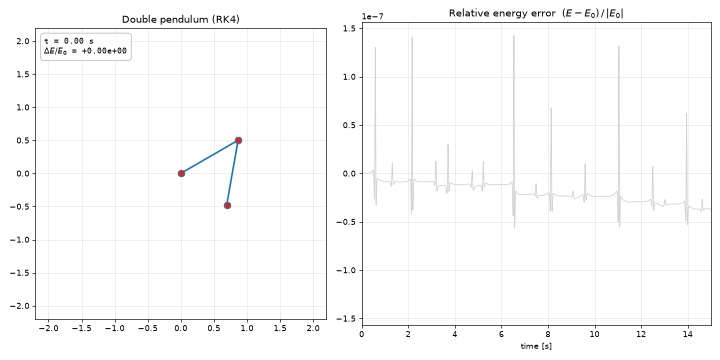

# Double Pendulum

A double pendulum simulation in Python. The equations of motion are derived from the Lagrangian, integrated with a fixed-step 4th-order Runge–Kutta scheme, and animated with matplotlib. The total energy is tracked so the accuracy of the integration can be checked.



*Left: the pendulum, with a trail behind the lower mass. Right: the relative energy error over time. The grey curve is the full run; the green curve fills in as the animation plays.*

## Quick start

```bash
python3 -m venv .venv
source .venv/bin/activate
pip install -r requirements.txt

python double_pendulum.py                                 # live animation
python double_pendulum.py --theta1 179 --theta2 179       # near-inverted start
python double_pendulum.py --save out.gif --dpi 60         # export a GIF
python double_pendulum.py --no-show                       # only print energy stats
```

Run `python double_pendulum.py --help` for all options: masses, rod lengths, `g`, initial angles and angular velocities, step size `--dt`, simulated time `--t-max`, `--fps`, trail length and `--dpi`. Saving to `.mp4` requires `ffmpeg`; `.gif` works out of the box.

## Physics

Two point masses $m_1, m_2$ hang on massless rigid rods of length $L_1, L_2$. The generalized coordinates are the angles $\theta_1, \theta_2$, measured from the downward vertical, with $\omega_i = \dot\theta_i$.

**Positions** (pivot at the origin, $y$ up):

```math
x_1 = L_1\sin\theta_1,\quad y_1 = -L_1\cos\theta_1,\qquad
x_2 = x_1 + L_2\sin\theta_2,\quad y_2 = y_1 - L_2\cos\theta_2
```

**Kinetic and potential energy:**

```math
T = \tfrac12 (m_1+m_2) L_1^2\omega_1^2 + \tfrac12 m_2 L_2^2 \omega_2^2 + m_2 L_1 L_2\, \omega_1\omega_2 \cos(\theta_1-\theta_2)
```

```math
V = -(m_1+m_2)\, g L_1 \cos\theta_1 - m_2\, g L_2 \cos\theta_2
```

**Equations of motion.** Applying the Euler–Lagrange equations to $\mathcal{L} = T - V$, with $\Delta = \theta_1 - \theta_2$, gives a linear system in the angular accelerations:

```math
\begin{pmatrix} (m_1+m_2)L_1 & m_2 L_2\cos\Delta \\ L_1\cos\Delta & L_2 \end{pmatrix}
\begin{pmatrix} \ddot\theta_1 \\ \ddot\theta_2 \end{pmatrix}
=
\begin{pmatrix} -m_2 L_2\,\omega_2^2 \sin\Delta - (m_1+m_2)\, g\sin\theta_1 \\ L_1\,\omega_1^2\sin\Delta - g\sin\theta_2 \end{pmatrix}
```

The determinant is $L_1L_2\,(m_1 + m_2\sin^2\Delta) > 0$, so the system can always be solved. The code solves this 2×2 system at every step rather than using the long expanded closed-form expressions.

## Numerical integration

The state $(\theta_1, \theta_2, \omega_1, \omega_2)$ is advanced with **classical RK4 at a fixed step** (default $\Delta t = 1$ ms):

- **Fixed step:** the animation needs states at evenly spaced times, so no interpolation is required.
- **4th order:** the global error scales as $\Delta t^4$, so the method is accurate and cheap. Accuracy matters because the system is chaotic.
- **Why not a symplectic method?** Simple explicit symplectic schemes such as leapfrog/Verlet need a separable Hamiltonian $H = T(p) + V(q)$. Here $T$ depends on $\cos(\theta_1-\theta_2)$, so it isn't separable, and a symplectic method would have to be implicit. RK4 is not symplectic, so energy drifts slowly. The energy plot measures that drift.

## Energy conservation check

Without friction or driving, $E = T + V$ is exactly conserved, so the relative error $(E - E_0)/|E_0|$ measures the integration error. Run: $\theta_1 = 120°$, $\theta_2 = -10°$, starting from rest, 30 s simulated:

| $\Delta t$ | max $\lvert\Delta E/E_0\rvert$ | improvement when $\Delta t$ is halved |
|---|---|---|
| 4 ms | 8.8 × 10⁻⁵ | — |
| 2 ms | 3.8 × 10⁻⁶ | 23× |
| 1 ms | 1.9 × 10⁻⁷ | 20× |

Halving the step improves the error by about 20×, consistent with the expected $2^4 = 16$× for a 4th-order method. This also checks the equations of motion: a wrong term would leave the energy error stuck at a fixed level as $\Delta t$ shrinks.

Reproduce it with:

```bash
for dt in 0.004 0.002 0.001; do python double_pendulum.py --no-show --dt $dt; done
```

Notes:
- The error grows in short spikes, when the pendulum whips around quickly (large $\omega$). The fixed step is coarsest relative to the motion there.
- For this start, $E_0 \approx 0.149$ J is small because the two potential terms nearly cancel. That makes the *relative* error look somewhat larger than it would for other starting angles.
- Small energy error does not mean the trajectory is accurate long-term. The system is chaotic, so tiny errors grow exponentially and the exact path is only predictable for a few tens of seconds. Energy conservation checks the physics, not the exact path.
