<div align="center">

# Double Pendulum Simulator

**Simulate, analyze and render the chaotic motion of a double pendulum.**


[](LICENSE)

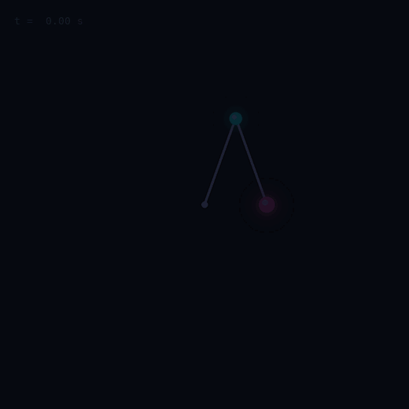

</div>

Double Pendulum Simulator is a double pendulum simulator in Python built as a chaos
laboratory. Its equations of motion come from a Lagrangian, and its
integrators have been checked for accuracy. It renders cinematic animations,
estimates Lyapunov exponents, computes Poincaré sections and initial-condition
maps, and keeps every result reproducible from a saved configuration. Every
animation in this README is rendered from an actual simulation.

## 30-second quick start

```bash
git clone https://github.com/Krishiv-Vaid/double-pendulum.git && cd double-pendulum
python3 -m venv .venv && source .venv/bin/activate
pip install -e ".[video]"           # numpy, scipy, matplotlib, pillow (+ bundled ffmpeg for MP4)

python double_pendulum.py           # the original animated simulator (still works exactly as before)
python -m pendulum_sim render --preset double_flip --t-max 8 -o flip.gif
python -m pendulum_sim lyapunov --preset classic
python -m pendulum_sim map --res 300 -o flip-map.png
```

## Features

| | |
|---|---|
| **Physics** | Lagrangian equations of motion, viscous damping, sinusoidal driving, energy balance, angular momentum, complex-step Jacobian. Separate models: moving pivot and N-link (triple) pendulum |
| **Integrators** | RK4 (scalar fast path plus a vectorized batch path), RK45 and DOP853 with dense output and event location |
| **Chaos analysis** | Lyapunov exponents (tangent and two-trajectory, validated on Lorenz), predictability horizons, Poincaré sections with root-found crossings, normal modes, equilibrium stability, spectra, recurrence |
| **Experiments** | Butterfly ensembles of 2–2000 pendulums with a numerical-error control, parallel cached chaos maps, 1D/2D parameter sweeps, integrator lab, 25 verified presets, 8 challenges with feedback, art search |
| **Visuals** | Strictly monochrome: white on black (default) or black on white. Supersampled renderer with 12 trail modes, optional particles, 5 camera modes, motion blur and greyscale ramps; series are distinguished by tone and dash, never by hue |
| **Export** | GIF, MP4, WebM, PNG sequences, 4K, transparent PNG, SVG, publication figures, CSV with units, reproducible zip bundles |
| **Engineering** | 150 tests, including an independent Euler–Lagrange check and the dashboard API; CI; benchmark suite; full documentation |

## Gallery

<table>
<tr>
<td align="center">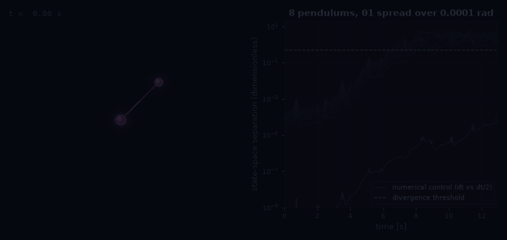<br><b>Butterfly effect</b>: 8 pendulums 0.0001 rad apart, with a log-scale separation plot and a numerical control</td>
<td align="center">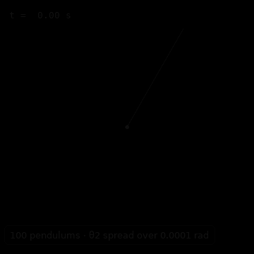<br><b>100 pendulums</b>: one rod splits into a fan</td>
</tr>
<tr>
<td align="center">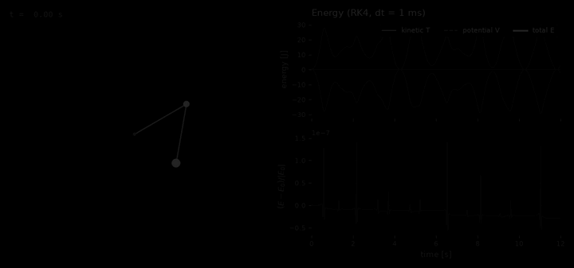<br><b>Energy</b>: T, V, E and the RK4 energy error on one clock</td>
<td align="center">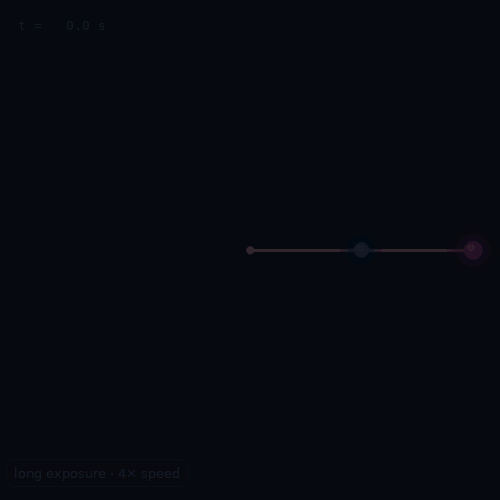<br><b>Long exposure</b>: 45 s of motion as a light painting</td>
</tr>
<tr>
<td align="center">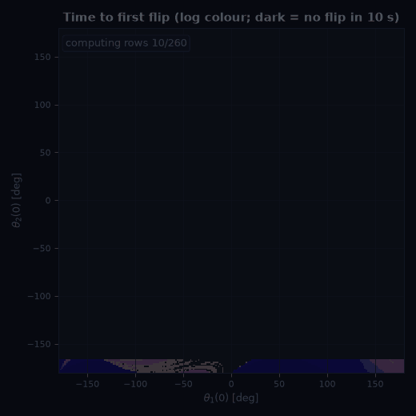<br><b>Chaos map</b>: time to first flip for every starting angle pair</td>
<td align="center">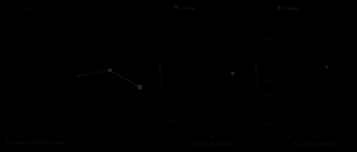<br><b>Phase space</b>: θ–ω projections growing in real time</td>
</tr>
</table>

<details>
<summary><b>14 more demos</b>: Poincaré sections, fractal zoom, integrator showdown, double flip, slow motion, gravity, mass ratio, damping, driving, Lyapunov growth…</summary>

| | |
|---|---|
| 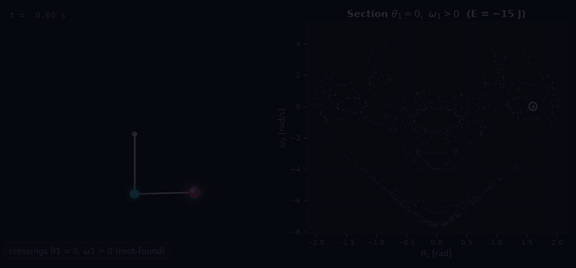 | 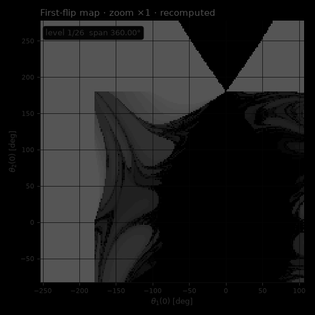 |
| Poincaré section at E = −15 J | Zoom into a recomputed flip map |
| 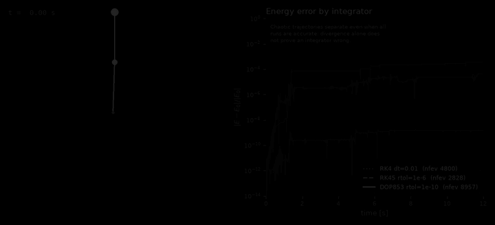 | 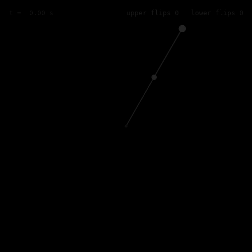 |
| RK4 vs RK45 vs DOP853 | Both arms flip |
| 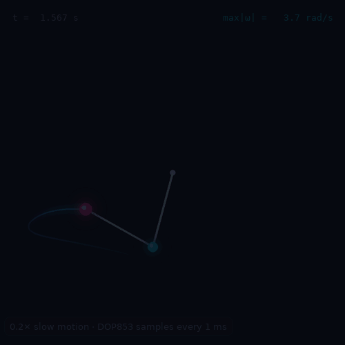 | 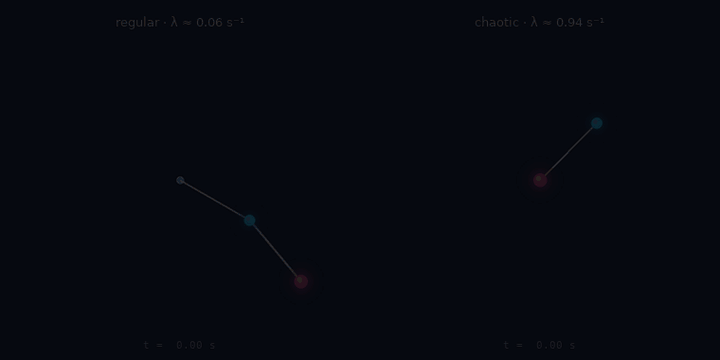 |
| 0.2× slow motion | Regular (λ ≈ 0.06 s⁻¹) vs chaotic (λ ≈ 0.94 s⁻¹) |
| 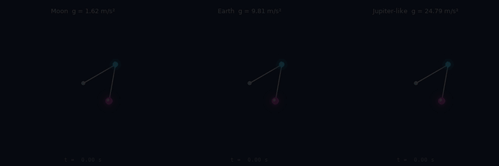 | 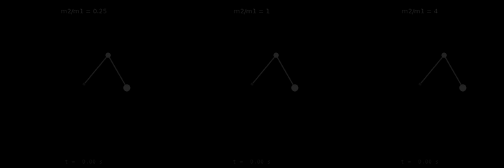 |
| Moon / Earth / Jupiter-like gravity | Mass ratios 0.25, 1, 4 |
| 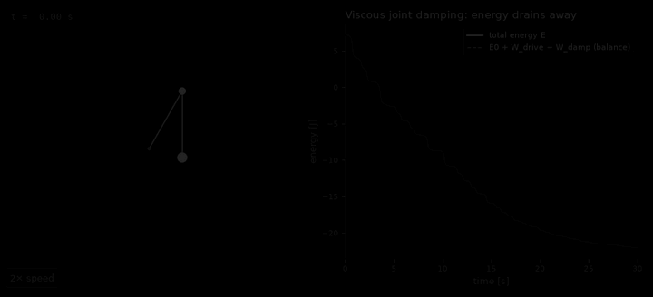 | 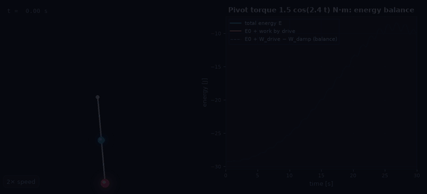 |
| Damping with energy balance | Near-resonant driving |
| 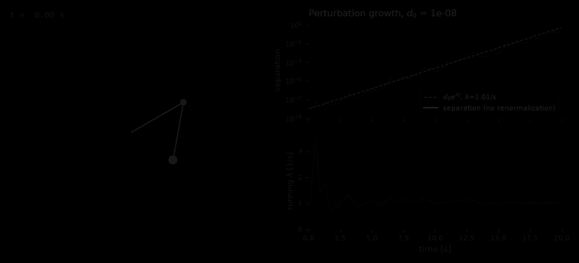 | 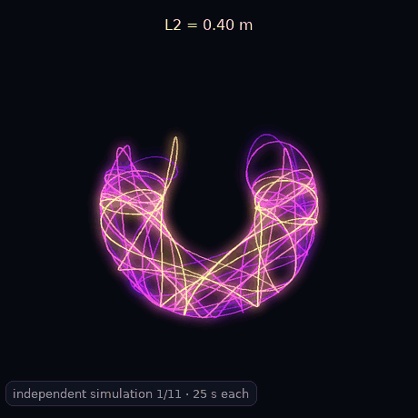 |
| Perturbation growth and running λ | Independent runs as L2 changes |

</details>

Every demo's exact parameters and reproduction command are in **[docs/gallery.md](docs/gallery.md)**.
Rebuild all assets with `python scripts/generate_gallery.py`. A 720p MP4 is in
[`assets/videos/`](assets/videos/).

## Interactive dashboard

```bash
python -m pendulum_sim serve            # opens http://localhost:8765 (add --port N, --no-browser)
```

The dashboard is a standard-library HTTP server (`pendulum_sim/app/`) with a canvas frontend that
needs no build step and no internet connection. It drives the same engine as the CLI. Numerical
state lives on the server and visual state in the browser, so changing a colour, trail or camera
never re-runs an integration. Heavy experiments run as background jobs with progress bars and a
Cancel button.

<table>
<tr>
<td>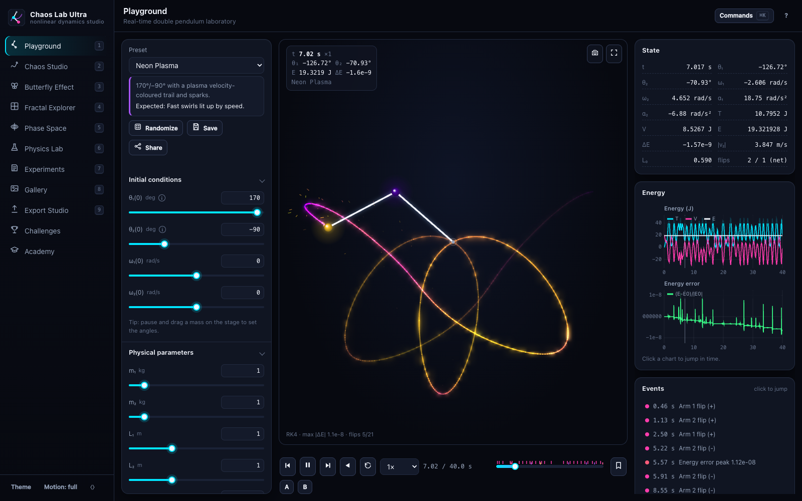<br><b>Playground</b>: every parameter, live energy diagnostics, and a time machine (scrub, step, reverse playback of recorded states, event bookmarks, A/B timestamp comparison)</td>
<td>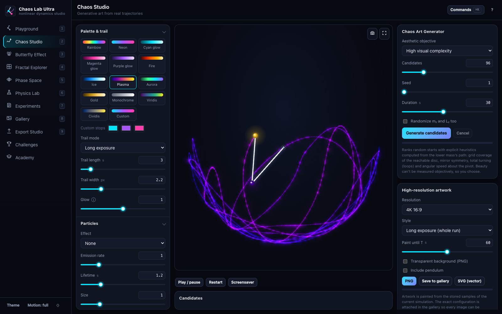<br><b>Chaos Studio</b>: four greyscale ramps (white, silver, black, gray), 12 trail modes, optional particles, camera and motion blur, an art generator, and 4K/SVG artwork with its exact config saved to the gallery</td>
</tr>
<tr>
<td>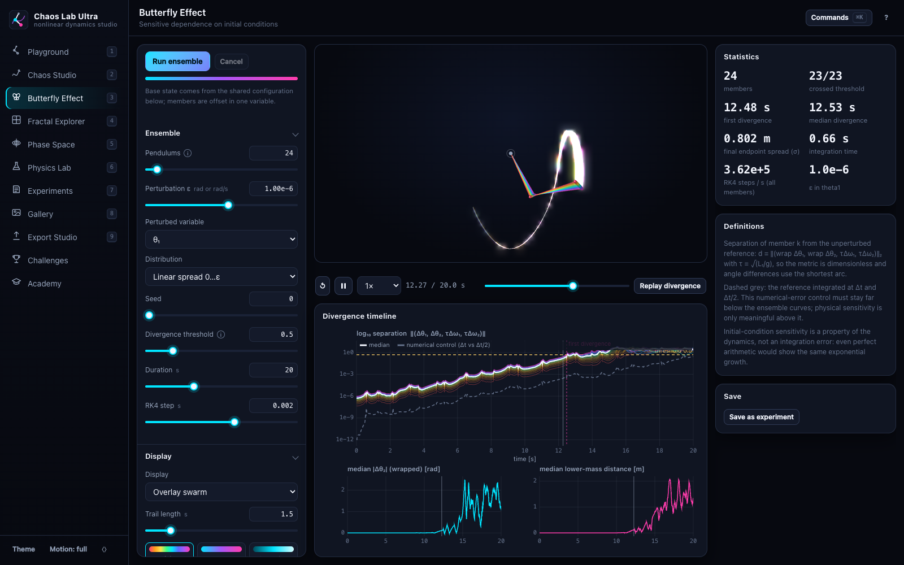<br><b>Butterfly Arena</b>: 2–400 pendulums, a log separation plot with threshold and numerical-error control, and a replay of the divergence moment</td>
<td>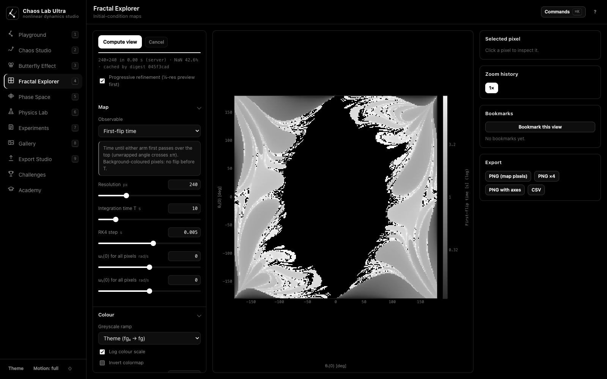<br><b>Fractal Explorer</b>: progressive maps that are recomputed on every pan or zoom, with zoom history, bookmarks, click-to-launch, and zoom-movie export</td>
</tr>
<tr>
<td>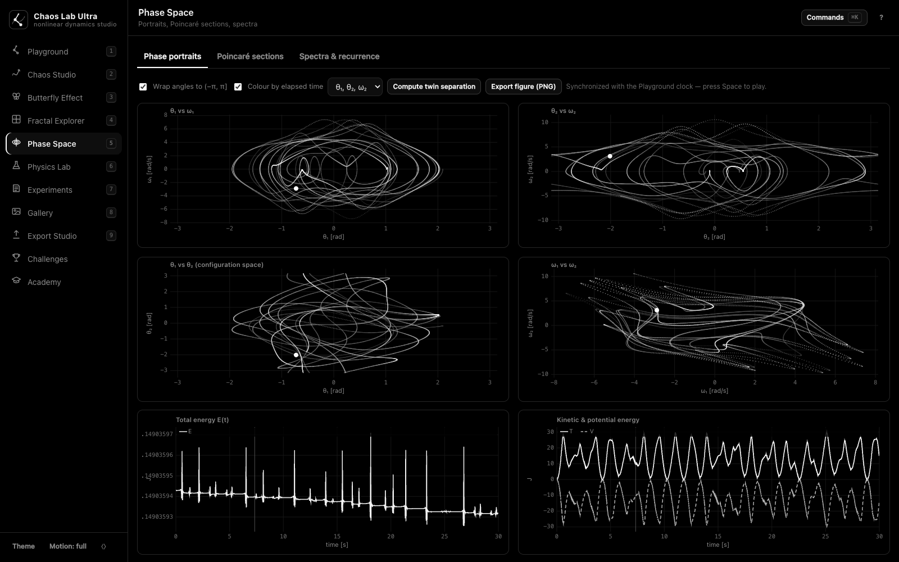<br><b>Phase Space</b>: four projections, a rotatable 3D projection, Poincaré sections, spectra, and recurrence plots</td>
<td>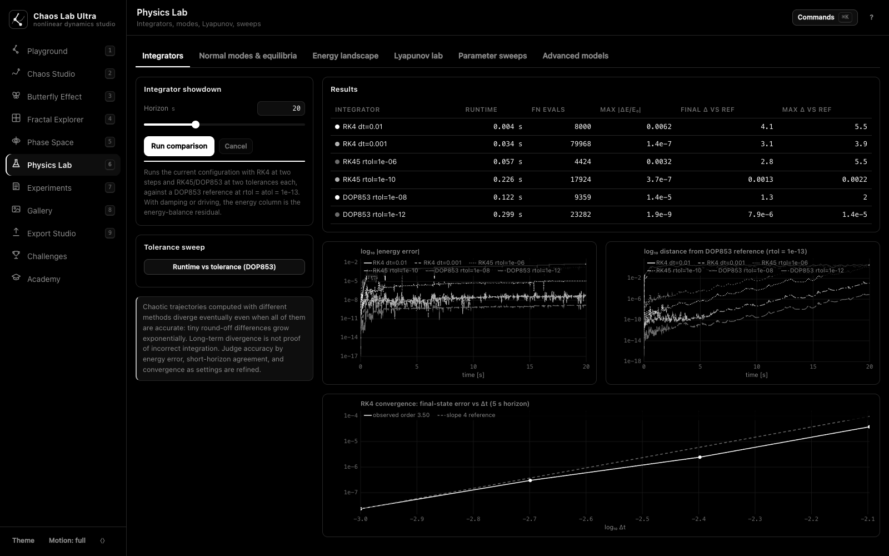<br><b>Physics Lab</b>: integrator showdown and RK4 convergence, normal modes, equilibria, energy landscape, a Lyapunov lab with Lorenz validation, sweeps, and the triple pendulum and moving pivot</td>
</tr>
</table>

Prefer black on white? Every view has a light theme: [Playground in light mode](assets/screenshots/playground-light.png).

The app also includes an **Experiment Notebook** (tags, favourites, duplicate, JSON import and export,
side-by-side comparison), an **Export Studio** (frame-exact GIF and MP4 through the server encoder,
WebM, PNG sequences, CSV, reproducible bundles, share links that encode the configuration in the URL),
**Challenges**, a 14-lesson **Academy**, a ⌘K command palette, keyboard shortcuts (`?`), light and dark
themes, reduced-motion mode, optional sonification and a 3D presentation view. The 3D view shows the
same planar motion; it is not a new degree of freedom. Experiments and artworks are stored in
`~/.pendulum_sim/` (override with `PENDULUM_SIM_HOME`). The server binds to `127.0.0.1` and has no
authentication, so treat it as a local tool.

## Physics

The pendulum is two point masses $m_1, m_2$ on massless rods $L_1, L_2$. The
angles are measured from the downward vertical, and $y$ points up.

```math
x_1 = L_1\sin\theta_1,\quad y_1 = -L_1\cos\theta_1,\qquad x_2 = x_1 + L_2\sin\theta_2,\quad y_2 = y_1 - L_2\cos\theta_2
```

```math
T = \tfrac12 (m_1+m_2) L_1^2\omega_1^2 + \tfrac12 m_2 L_2^2 \omega_2^2 + m_2 L_1 L_2\, \omega_1\omega_2 \cos(\theta_1-\theta_2)
```

```math
V = -(m_1+m_2)\, g L_1 \cos\theta_1 - m_2\, g L_2 \cos\theta_2, \qquad E = T + V
```

With $\Delta = \theta_1 - \theta_2$, the Euler–Lagrange equations of
$\mathcal L = T - V$ give

```math
\begin{pmatrix}
(m_1+m_2)L_1 & m_2L_2\cos\Delta \\
L_1\cos\Delta & L_2
\end{pmatrix}
\begin{pmatrix}
\ddot{\theta}_1 \\
\ddot{\theta}_2
\end{pmatrix}
=
\begin{pmatrix}
-m_2L_2\omega_2^2\sin\Delta-(m_1+m_2)g\sin\theta_1 \\
L_1\omega_1^2\sin\Delta-g\sin\theta_2
\end{pmatrix}
```

The determinant $L_1L_2(m_1 + m_2\sin^2\Delta)$ is always positive. Damping
and driving enter as generalized torques, and the code tracks the energy
balance $E(t) - E_0 = W_\text{drive} - W_\text{damp}$.

**[docs/physics.md](docs/physics.md)** has the full step-by-step derivation,
plus angular momentum (not conserved: gravity exerts a torque about the pivot),
normal modes, equilibria, the moving pivot and the N-link generalization.

## Numerical methods

* **RK4 (default).** Fixed-step, 4th order, with a uniform time grid for
  animation. The measured observed order is 4.05. A single trajectory uses a
  pure-float loop, which is about 20× faster than NumPy on a 4-element state.
* **RK45 / DOP853.** Adaptive embedded pairs with dense output, used for
  references, Poincaré event location and slow motion.
* **Why not a symplectic integrator?** The Hamiltonian isn't separable, because
  $T$ depends on $\cos(\theta_1-\theta_2)$, so explicit leapfrog doesn't apply.
  Instead of hiding the drift, Double Pendulum Simulator measures energy and its convergence.

The original simulator's energy convergence is unchanged:

| $\Delta t$ | max $\lvert\Delta E/E_0\rvert$ (30 s, θ = 120°/−10°) | improvement when $\Delta t$ is halved |
|---|---|---|
| 4 ms | 8.8 × 10⁻⁵ | — |
| 2 ms | 3.8 × 10⁻⁶ | 23× |
| 1 ms | 1.9 × 10⁻⁷ | 20× |

See **[docs/numerics.md](docs/numerics.md)** for event detection, the
Lyapunov estimator and the chaos-map algorithm.

## Chaos in 60 seconds

* **Sensitive dependence.** Starts 10⁻⁶ rad apart separate exponentially. For
  the classic start the finite-time Lyapunov exponent is about 1 s⁻¹, so the
  separation grows roughly e-fold every second.
* **Physics, not numerics.** The butterfly experiment runs a control (the same
  start at dt and dt/2). It stays orders of magnitude below the physical
  divergence.
* **Predictability horizon.** $T_p \approx \ln(\delta_\text{max}/\delta_0)/\lambda$.
  Measuring the start 1000× more precisely buys only about 7 s.
* **Regular islands.** Low-energy and some high-energy motion is regular. The
  Poincaré section shows islands (closed curves) coexisting with chaotic
  scatter.

The **[Chaos Academy](docs/academy.md)** has 14 lessons, each with a command
that reproduces it.

## Experiment recipes

```bash
python -m pendulum_sim presets                                   # 25 presets
python -m pendulum_sim simulate --preset double_flip --bundle flip.zip   # reproducible bundle (config + data + stamp)
python -m pendulum_sim butterfly --preset butterfly --n 50 --epsilon 1e-8
python -m pendulum_sim lyapunov --theta1 150 --theta2 150 --t-max 60 --scan --csv lyap.csv
python -m pendulum_sim poincare --energy -15 --n 10 -o section.png
python -m pendulum_sim map --observable sensitivity --res 400 -o sensitivity.png
python -m pendulum_sim map --t1 -120 -100 --t2 50 70 --res 300 -o zoom.png
python -m pendulum_sim integrators --preset integrator_challenge
python -m pendulum_sim modes --L1 1.2 --L2 0.6
python -m pendulum_sim challenge                                 # list challenges
python -m pendulum_sim challenge normal_mode theta1_deg=3 theta2_deg=4.24
python -m pendulum_sim art-search --objective symmetry --n 256   # candidates as configs
```

## Export

```bash
python -m pendulum_sim render --preset gradient_chaos -o reel.mp4 --video-preset reels --title "Chaos" --params
python -m pendulum_sim render --preset velocity_swirls -o clip.webm --camera smooth --energy-graph
python -m pendulum_sim render --preset classic -o ink.gif --theme light            # black on white
python -m pendulum_sim render --preset classic -o frames/ --fps 60          # PNG sequence
python -m pendulum_sim art --preset long_exposure --size 4k -o wallpaper.png --gallery
python -m pendulum_sim art --preset long_exposure --transparent -o sticker.png
python -m pendulum_sim art --preset long_exposure -o path.svg
python -m pendulum_sim figure --preset phase_space -o figure.pdf --theme light
python -m pendulum_sim simulate --preset classic --csv trajectory.csv
```

* **Video presets:** `youtube`, `reels`, `square`, `ultrawide`,
  `presentation`, `4k` and `gif`.
* **Stills:** `1080p`, `1440p`, `4k`, `square`, `ultrawide` and `phone`.
* **Sidecars:** every export writes a JSON sidecar with the exact
  configuration, style and a reproducibility stamp (version, commit,
  dependency versions).

## Validation

| Check | Result |
|---|---|
| Euler–Lagrange residual from an independent Cartesian Lagrangian | converges to 0 as O(Δt²); a deliberately wrong model fails |
| README matrix equation vs implementation | identical (`numpy.linalg.solve` vs Cramer) |
| RK4 order of accuracy | 4.05 observed |
| Lyapunov estimator on Lorenz-63 | 0.906 ± 0.06 (literature 0.9056) |
| Normal modes (equal masses and lengths) | √((2∓√2)g/L) exactly; θ2/θ1 = ±√2 |
| Poincaré crossings | θ1 ≡ 0 to 10⁻⁶ on re-integration |
| Damped and driven energy balance | residual < 10⁻⁵ of the characteristic energy |
| Angular momentum | dL/dt equals the gravitational torque |
| Preset descriptions | every machine-checkable claim verified |

Run all of them with `pytest`.

## Performance

Measured with `python -m pendulum_sim bench`. Full table and environment:
[benchmarks/results.md](benchmarks/results.md).

| Benchmark (Apple M4, Python 3.14) | Measured |
|---|---|
| Single trajectory, RK4 dt = 1 ms | 30 s of motion in 0.05 s (≈ 640k steps/s) |
| DOP853, rtol = atol = 1e-10, 30 s | 0.25 s, max \|ΔE/E0\| = 3.4 × 10⁻⁷ |
| 1000-pendulum ensemble, RK4 | 7.8 M pendulum-steps/s |
| First-flip map 200×200, 10 s horizon | 2.2 s |
| First-flip map 400×400 | 8.6 s on 1 process, 2.4 s on 9 (3.6× speed-up) |
| Raster renderer, 640×640, default style | 103 frames/s |
| MP4 export, 5 s at 1280×720, 30 fps | 3.7 s |

Measured at a system load average of about 3.5 (other applications were running).
Rendering throughput is reported separately from integration throughput.

## Architecture

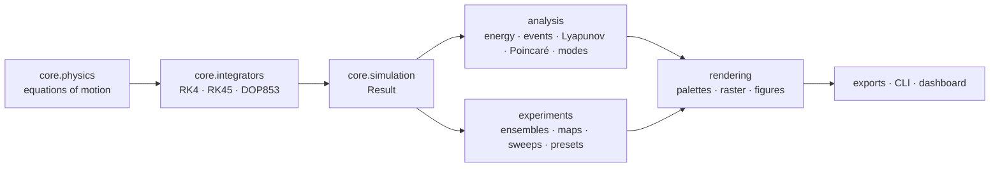

Details are in [docs/architecture.md](docs/architecture.md).

```
pendulum_sim/
├── core/         config, physics, integrators, simulation, nlink, pivot
├── analysis/     events, lyapunov, poincare, linear, spectral
├── experiments/  ensemble, maps, sweeps, integrator_lab, presets, challenges, art
├── rendering/    palettes, raster, figures
├── exports/      media, studio, data
├── cli.py        python -m pendulum_sim …
└── benchmarks.py
double_pendulum.py   original entry point (same CLI and output)
scripts/             generate_gallery.py, build_gallery_docs.py
tests/               pytest suite
docs/                physics, numerics, architecture, gallery, academy
```

## Development

```bash
pip install -e ".[dev]"
pytest -q              # ~1 minute
ruff check .
python -m pendulum_sim bench --quick
```

## Troubleshooting

| Symptom | Fix |
|---|---|
| `MP4/WebM export needs ffmpeg` | `pip install imageio-ffmpeg` (bundles a binary) or install system ffmpeg |
| No window appears with `double_pendulum.py` | You are on a headless backend. Use `--save out.gif`, or set `MPLBACKEND=MacOSX`/`TkAgg` |
| Chaos map is slow | Lower `--res` or `--t-max`. Maps of 120k+ pixels use all cores, and results are cached in `~/.cache/pendulum_sim/maps` |
| `ValueError: ... exceeds ... safety limit` | The requested run is too large (e.g. a tiny dt with a long t_max). Reduce it or use an adaptive method |
| Energy error looks large | Halve `--dt` or tighten `--rtol`. For forced runs the diagnostic is the energy-balance residual |

## Contributing

See [CONTRIBUTING.md](CONTRIBUTING.md). Physics changes need a test that would
fail if the physics were wrong. Visual changes need a regenerated asset and an
updated sidecar.

## Roadmap

- [x] Scientific foundation: verified equations of motion, tests, CI
- [x] Cinematic renderer, export studio, 20-demo gallery
- [x] Chaos analysis: ensembles, Lyapunov, Poincaré, maps, sweeps
- [x] Advanced physics: damping, driving, normal modes, equilibria, moving pivot, triple pendulum
- [x] Interactive dashboard: playground with time machine, studio, butterfly arena, fractal explorer, phase space, physics lab, notebook, gallery, export studio, challenges, academy
- [x] Audio sonification and the 3D presentation view (dashboard)
- [ ] Optional Numba kernels for very large maps (benchmark first)
- [ ] Browser-side automated UI tests (the backend API is covered by `tests/test_app.py`)
- [ ] Spherical double pendulum (needs a new, separately derived model)

## License

[MIT](LICENSE) © 2026 Krishiv Vaid
