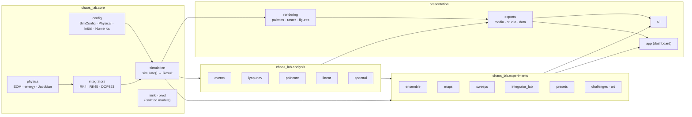

# Architecture

**Physics engine → numerical integrator → simulation results → diagnostics →
visualization → export/UI.**

## Design rules

1. **The physics is pure and vectorized.** `physics.derivatives(t, y, p)`
   accepts states of shape `(..., 4)` and parameters that may be arrays. The
   same function drives single runs, ensembles, chaos maps and parameter
   sweeps.
2. **Configurations are data.** `SimConfig` is a frozen dataclass that
   validates itself, round-trips through JSON and has a stable digest. Every
   asset, export and bundle stores the configuration that produced it.
3. **Numbers and pictures are separate.** Rendering reads samples and never
   writes back. Glow, particles and camera motion cannot affect the physics,
   and a test asserts this.
4. **Big data stays out of configs.** Bundles store `config.json` next to
   `trajectory.npz`. Maps are cached as `.npy` files keyed by the specification
   hash.
5. **Long jobs are bounded and cancellable.** Maps, exports and Lyapunov runs
   accept progress and cancel callbacks. Resolution and step-count limits are
   enforced in validation.
6. **Claims are tested.** Every machine-checkable statement in the preset
   descriptions is verified by `tests/test_presets.py`.

## Module map

| Module | Responsibility |
|---|---|
| `core/config.py` | validated dataclasses, JSON, digests |
| `core/physics.py` | equations of motion, kinematics, energies, angular momentum, complex-step Jacobian, angle wrapping |
| `core/integrators.py` | RK4 (vectorized and scalar fast path), SciPy adaptive wrapper |
| `core/simulation.py` | `simulate()` and `Result` with energy and energy-balance diagnostics |
| `core/nlink.py`, `core/pivot.py` | triple/N-link pendulum and moving-pivot models |
| `analysis/events.py` | flips, rotation counts, peaks, timeline bookmarks |
| `analysis/lyapunov.py` | Benettin estimator (tangent and two-trajectory), sensitivity scan, Lorenz validator |
| `analysis/poincare.py` | event-based sections, fixed-energy initial conditions |
| `analysis/linear.py` | normal modes, linear solution, equilibria |
| `analysis/spectral.py` | FFT spectra, recurrence matrices |
| `experiments/ensemble.py` | batched RK4, butterfly experiment with numerical control |
| `experiments/maps.py` | initial-condition maps: chunked, parallel, cached, cancellable |
| `experiments/sweeps.py` | 1D/2D parameter sweeps, tolerance sweeps |
| `experiments/integrator_lab.py` | method comparison, RK4 convergence order |
| `experiments/presets.py` | 25 presets with verified claims |
| `experiments/challenges.py`, `art.py` | challenge evaluators, art-search heuristics |
| `rendering/palettes.py` | design tokens and gradients (incl. colour-blind-safe) |
| `rendering/raster.py` | supersampled additive-glow renderer, trails, particles, camera |
| `rendering/figures.py` | Matplotlib theme helpers |
| `exports/media.py` | GIF/MP4/WebM/PNG writers, presets |
| `exports/studio.py` | animations, stills, SVG, scientific figures |
| `exports/data.py` | CSV with units, bundles, reproducibility stamp |
| `cli.py` | `python -m chaos_lab …` |
| `benchmarks.py` | reproducible benchmark suite |
| `app/` | interactive web dashboard (stdlib HTTP server + canvas frontend) |
