# Chaos Lab Ultra — Demo Gallery

Every animation here is rendered from an actual simulation. Exact parameters below are read from the sidecar file that produced each asset (`assets/gifs/configs/<name>.json`). Physical time labels show simulated seconds; playback speed is stated when it is not 1×.

Regenerate everything with `python scripts/generate_gallery.py` (≈ 4 minutes on an Apple M4), or a single asset with `--only <name>`.

## Cinematic Art

### Hero Chaos

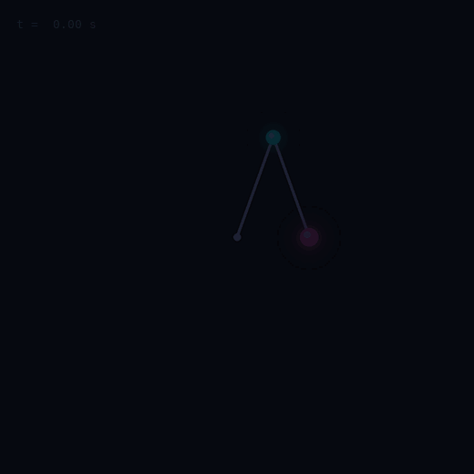

A single chaotic double pendulum with a rainbow trail. The glow is a rendering effect added to the light layer; the trajectory itself is untouched.

- **Parameters:** θ1(0) = 160°, θ2(0) = 20°; m1 = 1, m2 = 1 kg; L1 = 1, L2 = 1 m; g = 9.81 m/s²; RK4 dt = 0.001 s
- **Playback speed:** 1
- **Frames:** 163 at 18 fps
- **Reproduce:** `python scripts/generate_gallery.py --only hero-chaos`
- **Saved configuration:** [`configs/hero-chaos.json`](../assets/gifs/configs/hero-chaos.json)

### Long Exposure

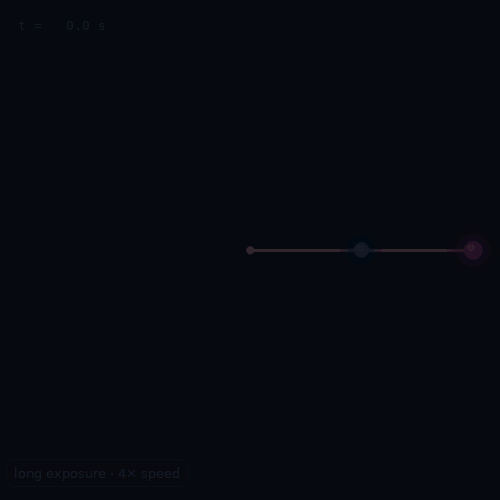

The lower bob paints its path over 45 s of simulated time (4× playback). Each pixel keeps the brightest value it has seen.

- **Parameters:** θ1(0) = 90°, θ2(0) = 90°; m1 = 1, m2 = 1 kg; L1 = 1, L2 = 1 m; g = 9.81 m/s²; RK4 dt = 0.001 s
- **Playback speed:** 4
- **Frames:** 123 at 10 fps
- **Reproduce:** `python scripts/generate_gallery.py --only long-exposure`
- **Saved configuration:** [`configs/long-exposure.json`](../assets/gifs/configs/long-exposure.json)

### Parameter Morph

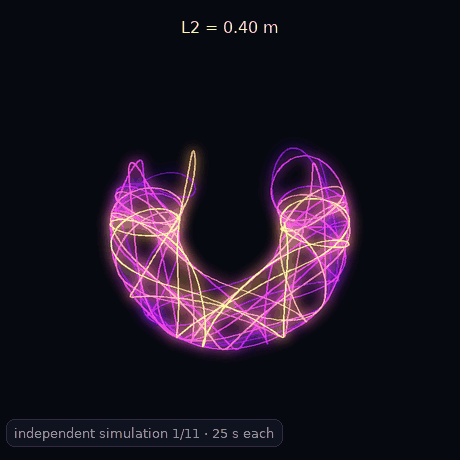

Eleven *independent* simulations with the lower rod length stepped from 0.4 m to 1.4 m. The cross-fades are visual transitions between separate runs, not physical evolution.

- **L2=0.40:** θ1(0) = 140°, θ2(0) = 100°; m1 = 1, m2 = 1 kg; L1 = 1, L2 = 0.4 m; g = 9.81 m/s²; RK4 dt = 0.001 s
- **L2=0.50:** θ1(0) = 140°, θ2(0) = 100°; m1 = 1, m2 = 1 kg; L1 = 1, L2 = 0.5 m; g = 9.81 m/s²; RK4 dt = 0.001 s
- **L2=0.60:** θ1(0) = 140°, θ2(0) = 100°; m1 = 1, m2 = 1 kg; L1 = 1, L2 = 0.6 m; g = 9.81 m/s²; RK4 dt = 0.001 s
- **L2=0.70:** θ1(0) = 140°, θ2(0) = 100°; m1 = 1, m2 = 1 kg; L1 = 1, L2 = 0.7 m; g = 9.81 m/s²; RK4 dt = 0.001 s
- **L2=0.80:** θ1(0) = 140°, θ2(0) = 100°; m1 = 1, m2 = 1 kg; L1 = 1, L2 = 0.8 m; g = 9.81 m/s²; RK4 dt = 0.001 s
- **L2=0.90:** θ1(0) = 140°, θ2(0) = 100°; m1 = 1, m2 = 1 kg; L1 = 1, L2 = 0.9 m; g = 9.81 m/s²; RK4 dt = 0.001 s
- **L2=1.00:** θ1(0) = 140°, θ2(0) = 100°; m1 = 1, m2 = 1 kg; L1 = 1, L2 = 1 m; g = 9.81 m/s²; RK4 dt = 0.001 s
- **L2=1.10:** θ1(0) = 140°, θ2(0) = 100°; m1 = 1, m2 = 1 kg; L1 = 1, L2 = 1.1 m; g = 9.81 m/s²; RK4 dt = 0.001 s
- **L2=1.20:** θ1(0) = 140°, θ2(0) = 100°; m1 = 1, m2 = 1 kg; L1 = 1, L2 = 1.2 m; g = 9.81 m/s²; RK4 dt = 0.001 s
- **L2=1.30:** θ1(0) = 140°, θ2(0) = 100°; m1 = 1, m2 = 1 kg; L1 = 1, L2 = 1.3 m; g = 9.81 m/s²; RK4 dt = 0.001 s
- **L2=1.40:** θ1(0) = 140°, θ2(0) = 100°; m1 = 1, m2 = 1 kg; L1 = 1, L2 = 1.4 m; g = 9.81 m/s²; RK4 dt = 0.001 s
- **Frames:** 143 at 10 fps
- **Reproduce:** `python scripts/generate_gallery.py --only parameter-morph`
- **Saved configuration:** [`configs/parameter-morph.json`](../assets/gifs/configs/parameter-morph.json)

### Cinematic Showcase

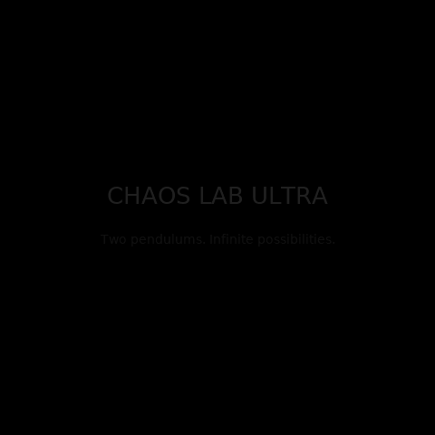

Montage of independent verified simulations.

- **Frames:** 197 at 10 fps
- **Reproduce:** `python scripts/generate_gallery.py --only cinematic-showcase`
- **Saved configuration:** [`configs/cinematic-showcase.json`](../assets/gifs/configs/cinematic-showcase.json)

## Butterfly Effect

### Butterfly Effect

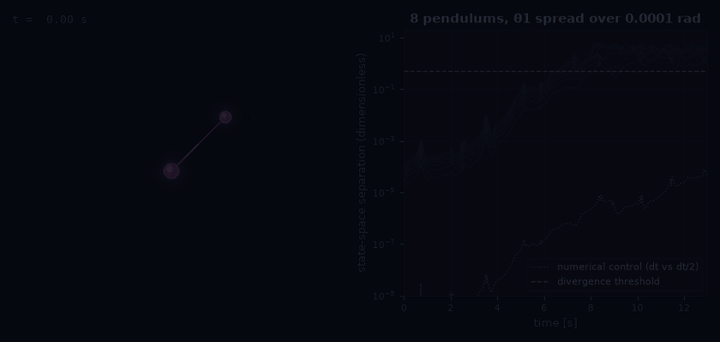

Eight pendulums whose initial θ1 values span 1e-4 rad. The right panel shows each member's state-space separation from the reference on a log scale; the dotted curve is the numerical control (same start, dt vs dt/2), which stays orders of magnitude below the physical divergence.

- **Parameters:** θ1(0) = 135°, θ2(0) = -45°; m1 = 1, m2 = 1 kg; L1 = 1, L2 = 1 m; g = 9.81 m/s²; RK4 dt = 0.001 s
- **Playback speed:** 1
- **Pendulums:** 8
- **Spread (rad):** 0.0001
- **Frames:** 156 at 12 fps
- **Reproduce:** `python scripts/generate_gallery.py --only butterfly-effect`
- **Saved configuration:** [`configs/butterfly-effect.json`](../assets/gifs/configs/butterfly-effect.json)

### 100 Pendulums

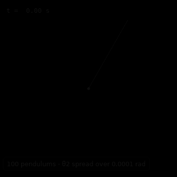

One hundred pendulums spread over 1e-4 rad in θ2: a single rod splits into a rainbow fan.

- **Parameters:** θ1(0) = 150°, θ2(0) = 150°; m1 = 1, m2 = 1 kg; L1 = 1, L2 = 1 m; g = 9.81 m/s²; RK4 dt = 0.002 s
- **Playback speed:** 1
- **Pendulums:** 100
- **Spread (rad):** 0.0001
- **Frames:** 161 at 10 fps
- **Reproduce:** `python scripts/generate_gallery.py --only pendulum-swarm`
- **Saved configuration:** [`configs/pendulum-swarm.json`](../assets/gifs/configs/pendulum-swarm.json)

### Lyapunov Growth

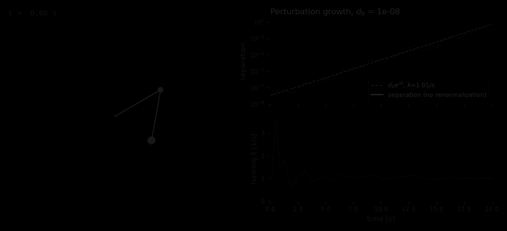

Separation of two trajectories started 1e-8 apart (no renormalization) against d0·e^(λt), and the running finite-time Lyapunov estimate from the tangent-space method.

- **Parameters:** θ1(0) = 120°, θ2(0) = -10°; m1 = 1, m2 = 1 kg; L1 = 1, L2 = 1 m; g = 9.81 m/s²; RK4 dt = 0.001 s
- **Finite-time λ (1/s):** 1.01
- **Frames:** 301 at 15 fps
- **Reproduce:** `python scripts/generate_gallery.py --only lyapunov-growth`
- **Saved configuration:** [`configs/lyapunov-growth.json`](../assets/gifs/configs/lyapunov-growth.json)

## Physics Experiments

### Energy Conservation

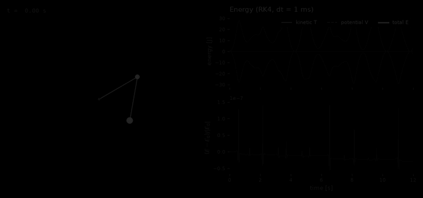

Kinetic, potential and total energy on the same clock as the motion, with the relative energy error of RK4 at dt = 1 ms.

- **Parameters:** θ1(0) = 120°, θ2(0) = -10°; m1 = 1, m2 = 1 kg; L1 = 1, L2 = 1 m; g = 9.81 m/s²; RK4 dt = 0.001 s
- **Playback speed:** 1
- **max |ΔE/E0|:** 1.41e-07
- **Frames:** 181 at 15 fps
- **Reproduce:** `python scripts/generate_gallery.py --only energy-conservation`
- **Saved configuration:** [`configs/energy-conservation.json`](../assets/gifs/configs/energy-conservation.json)

### Double Flip

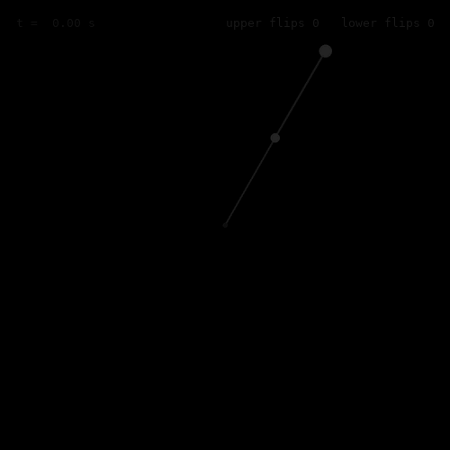

Both arms complete full rotations (verified by flip-event detection; the counter shows the detected events). Particle bursts fire at flips.

- **Parameters:** θ1(0) = 150°, θ2(0) = 150°; m1 = 1, m2 = 1 kg; L1 = 1, L2 = 1 m; g = 9.81 m/s²; RK4 dt = 0.001 s
- **Playback speed:** 1
- **Frames:** 101 at 10 fps
- **Reproduce:** `python scripts/generate_gallery.py --only double-flip`
- **Saved configuration:** [`configs/double-flip.json`](../assets/gifs/configs/double-flip.json)

### Slow Motion

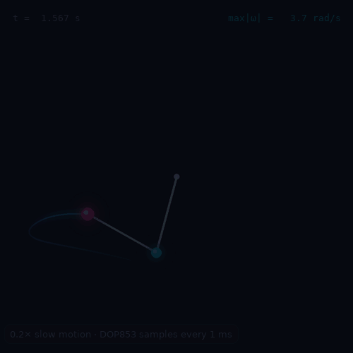

The fastest moment of a chaotic run, replayed at 0.2× from DOP853 samples taken every 1 ms.

- **Parameters:** θ1(0) = 120°, θ2(0) = -10°; m1 = 1, m2 = 1 kg; L1 = 1, L2 = 1 m; g = 9.81 m/s²; DOP853 rtol = 1e-11
- **Playback speed:** 0.2
- **Frames:** 61 at 10 fps
- **Reproduce:** `python scripts/generate_gallery.py --only slow-motion`
- **Saved configuration:** [`configs/slow-motion.json`](../assets/gifs/configs/slow-motion.json)

### Gravity Playground

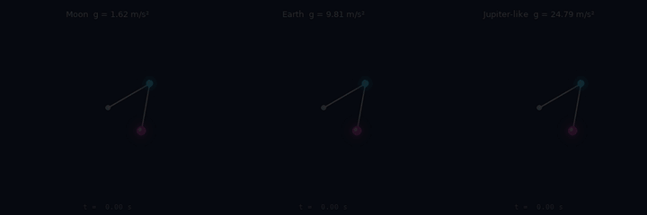

Identical starts under Moon, Earth and Jupiter-like constant gravity, all on the same physical clock (simplified constant-gravity experiments).

- **Moon  g = 1.62 m/s²:** θ1(0) = 120°, θ2(0) = -10°; m1 = 1, m2 = 1 kg; L1 = 1, L2 = 1 m; g = 1.62 m/s²; RK4 dt = 0.001 s
- **Earth  g = 9.81 m/s²:** θ1(0) = 120°, θ2(0) = -10°; m1 = 1, m2 = 1 kg; L1 = 1, L2 = 1 m; g = 9.81 m/s²; RK4 dt = 0.001 s
- **Jupiter-like  g = 24.79 m/s²:** θ1(0) = 120°, θ2(0) = -10°; m1 = 1, m2 = 1 kg; L1 = 1, L2 = 1 m; g = 24.79 m/s²; RK4 dt = 0.001 s
- **Playback speed:** 1
- **Frames:** 151 at 15 fps
- **Reproduce:** `python scripts/generate_gallery.py --only gravity-comparison`
- **Saved configuration:** [`configs/gravity-comparison.json`](../assets/gifs/configs/gravity-comparison.json)

### Mass Ratio

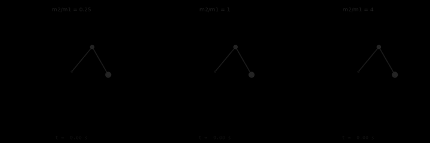

m2/m1 = 0.25, 1 and 4 from the same start.

- **m2/m1 = 0.25:** θ1(0) = 140°, θ2(0) = 30°; m1 = 1, m2 = 0.25 kg; L1 = 1, L2 = 1 m; g = 9.81 m/s²; RK4 dt = 0.001 s
- **m2/m1 = 1:** θ1(0) = 140°, θ2(0) = 30°; m1 = 1, m2 = 1 kg; L1 = 1, L2 = 1 m; g = 9.81 m/s²; RK4 dt = 0.001 s
- **m2/m1 = 4:** θ1(0) = 140°, θ2(0) = 30°; m1 = 1, m2 = 4 kg; L1 = 1, L2 = 1 m; g = 9.81 m/s²; RK4 dt = 0.001 s
- **Playback speed:** 1
- **Frames:** 151 at 15 fps
- **Reproduce:** `python scripts/generate_gallery.py --only mass-ratio`
- **Saved configuration:** [`configs/mass-ratio.json`](../assets/gifs/configs/mass-ratio.json)

### Damped Motion

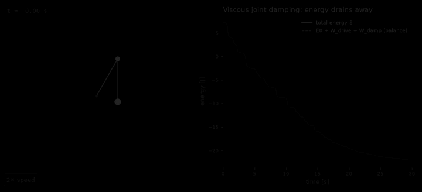

Viscous joint damping drains energy; the dashed curve is the energy balance E0 + W_drive − W_damp, which closes to quadrature accuracy.

- **Parameters:** θ1(0) = 150°, θ2(0) = 0°; m1 = 1, m2 = 1 kg; L1 = 1, L2 = 1 m; g = 9.81 m/s²; damping b1 = 0.05, b2 = 0.05 N·m·s/rad; DOP853 rtol = 1e-10
- **Playback speed:** 2
- **Frames:** 226 at 15 fps
- **Reproduce:** `python scripts/generate_gallery.py --only damped-pendulum`
- **Saved configuration:** [`configs/damped-pendulum.json`](../assets/gifs/configs/damped-pendulum.json)

### Driven Motion

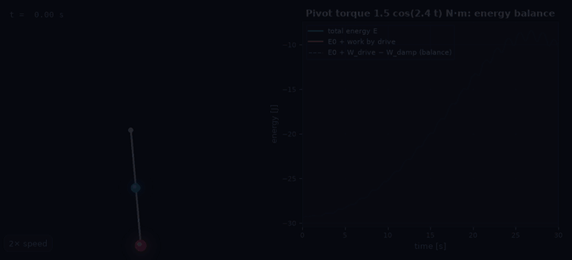

A sinusoidal pivot torque near the slow normal-mode frequency pumps energy in; the work done by the drive is integrated alongside.

- **Parameters:** θ1(0) = 5°, θ2(0) = 5°; m1 = 1, m2 = 1 kg; L1 = 1, L2 = 1 m; g = 9.81 m/s²; drive 1.5 cos(2.4 t) N·m; DOP853 rtol = 1e-10
- **Playback speed:** 2
- **Frames:** 226 at 15 fps
- **Reproduce:** `python scripts/generate_gallery.py --only driven-pendulum`
- **Saved configuration:** [`configs/driven-pendulum.json`](../assets/gifs/configs/driven-pendulum.json)

## Chaos Maps

### Chaos Heatmap

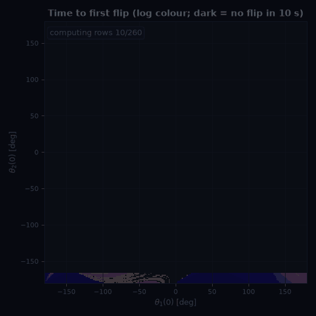

A first-flip map computed row by row: time until either arm passes over the top, for every starting angle pair (released from rest).

- **Map:** 260×260 pixels, θ ranges [-180.0, 180.0]°, t_max 10 s, RK4 dt 0.005 s
- **Frames:** 51 at 12 fps
- **Reproduce:** `python scripts/generate_gallery.py --only chaos-map`
- **Saved configuration:** [`configs/chaos-map.json`](../assets/gifs/configs/chaos-map.json)

### Fractal Zoom

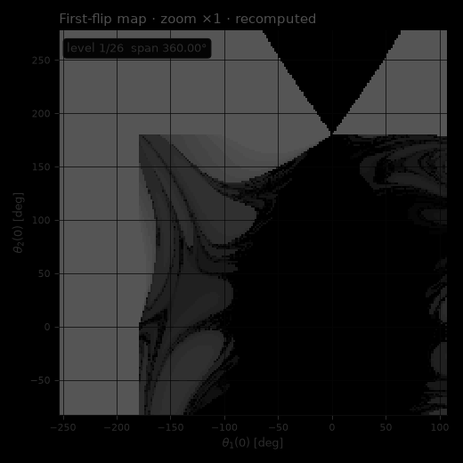

A zoom into a boundary region of the first-flip map. Every level is recomputed from initial conditions — nothing is upscaled. Intricate boundaries are a hallmark of sensitivity, not a proof of fractality.

- **Zoom centre (deg):** [-73.5, 97.5]
- **Frames:** 66 at 10 fps
- **Reproduce:** `python scripts/generate_gallery.py --only fractal-zoom`
- **Saved configuration:** [`configs/fractal-zoom.json`](../assets/gifs/configs/fractal-zoom.json)

## Scientific Analysis

### Phase Space

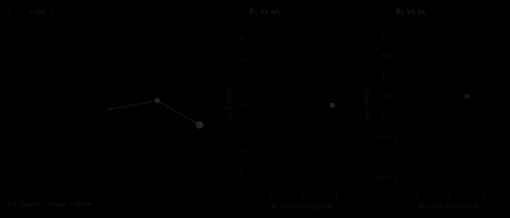

Pendulum motion beside its θ–ω projections (2D projections of the 4D state space; angles wrapped).

- **Parameters:** θ1(0) = 100°, θ2(0) = 60°; m1 = 1, m2 = 1 kg; L1 = 1, L2 = 1 m; g = 9.81 m/s²; RK4 dt = 0.001 s
- **Playback speed:** 2
- **Frames:** 181 at 15 fps
- **Reproduce:** `python scripts/generate_gallery.py --only phase-space`
- **Saved configuration:** [`configs/phase-space.json`](../assets/gifs/configs/phase-space.json)

### Poincaré Section

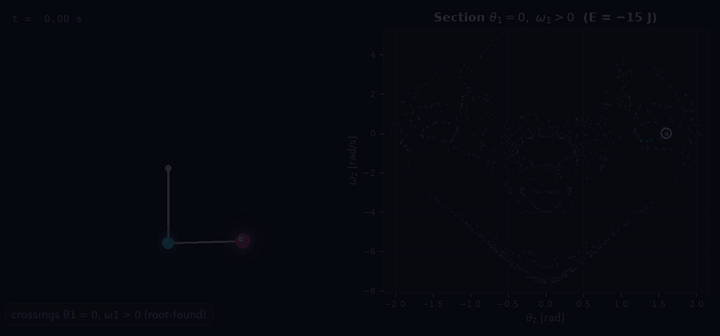

Root-found crossings of θ1 = 0 with ω1 > 0 appear as the live trajectory crosses; faint points are other trajectories at the same energy.

- **Energy (J):** -15
- **Section:** theta1 = 0 mod 2pi, omega1 > 0
- **Frames:** 266 at 15 fps
- **Reproduce:** `python scripts/generate_gallery.py --only poincare-section`
- **Saved configuration:** [`configs/poincare-section.json`](../assets/gifs/configs/poincare-section.json)

### Regular vs Chaotic

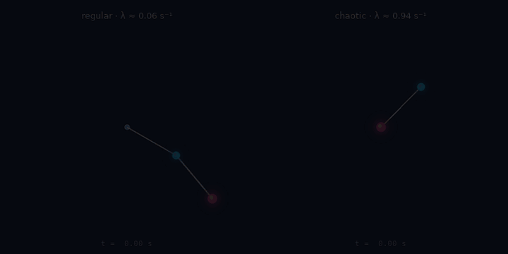

A regular and a chaotic start side by side, labelled with their finite-time Lyapunov estimates.

- **regular · λ ≈ 0.06 s⁻¹:** θ1(0) = 60°, θ2(0) = 40°; m1 = 1, m2 = 1 kg; L1 = 1, L2 = 1 m; g = 9.81 m/s²; RK4 dt = 0.001 s
- **chaotic · λ ≈ 0.94 s⁻¹:** θ1(0) = 135°, θ2(0) = -45°; m1 = 1, m2 = 1 kg; L1 = 1, L2 = 1 m; g = 9.81 m/s²; RK4 dt = 0.001 s
- **Playback speed:** 1
- **Frames:** 211 at 15 fps
- **Reproduce:** `python scripts/generate_gallery.py --only regular-vs-chaotic`
- **Saved configuration:** [`configs/regular-vs-chaotic.json`](../assets/gifs/configs/regular-vs-chaotic.json)

## Integrator Comparisons

### Integrator Showdown

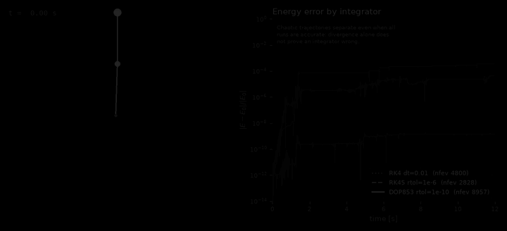

RK4 (dt = 0.01 s), RK45 (rtol 1e-6) and DOP853 (rtol 1e-10) from a near-inverted start, with their energy errors. The trajectories separate after a few seconds even though all three conserve energy well: divergence of chaotic runs is not, by itself, evidence of a wrong integrator.

- **Parameters:** θ1(0) = 178°, θ2(0) = 180°; m1 = 1, m2 = 1 kg; L1 = 1, L2 = 1 m; g = 9.81 m/s²; RK4 dt = 0.001 s
- **Frames:** 181 at 15 fps
- **Reproduce:** `python scripts/generate_gallery.py --only integrator-comparison`
- **Saved configuration:** [`configs/integrator-comparison.json`](../assets/gifs/configs/integrator-comparison.json)

## Video

[`assets/videos/hero-chaos-720p.mp4`](../assets/videos/hero-chaos-720p.mp4) — 20 s, 1280×720, 30 fps, with parameter overlay. Reproduce: `python scripts/generate_gallery.py --only video-hero`.
