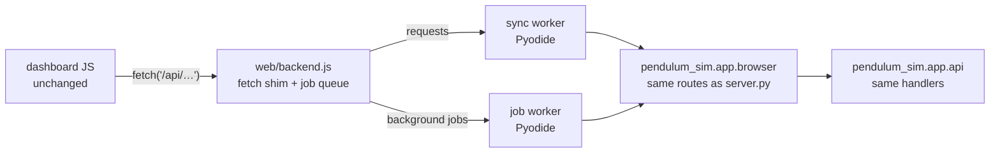

# Web demo

The dashboard is published at **https://krishiv-vaid.github.io/double-pendulum/**.
Nothing in it is a JavaScript rewrite: the page runs this Python package in the
browser with [Pyodide](https://pyodide.org) (CPython compiled to WebAssembly,
with NumPy and SciPy), so every number comes from the same code as the CLI and
the local server.

## How it works

The dashboard frontend (`pendulum_sim/app/static/`) talks to a JSON API at
`/api/*`. Locally that API is `server.py`. In the web demo there is no server:



* **`web/backend.js`** loads before the dashboard and replaces `window.fetch`
  for same-origin `/api/` URLs. Everything else goes to the network as usual.
* **`web/pyworker.js`** is a web worker that loads Pyodide, NumPy and SciPy,
  unpacks `pendulum_sim.zip` and calls `pendulum_sim.app.browser`. Pillow
  (GIF export) and Matplotlib load the first time something imports them.
* **`pendulum_sim/app/browser.py`** routes a request to the same handlers as
  `server.py` and returns `(status, content type, body)`.
* Two workers run: one answers ordinary requests, the other runs background
  jobs (chaos maps, ensembles, Lyapunov scans…), so the playground stays
  responsive while a job computes. A running job is cancelled by stopping its
  worker; a fresh one starts for the next job.
* Experiments and gallery artworks are kept in the browser (IndexedDB), so
  they survive a reload, but they are per browser and per device.

## Differences from the local app

| | Local (`python -m pendulum_sim serve`) | Web demo |
|---|---|---|
| Start-up | instant | ~30 MB download on the first visit (cached afterwards), a few seconds after that |
| Speed | native; big maps use every core | about 2–3× slower, one core per worker |
| MP4 export | yes, with `imageio-ffmpeg` | no (GIF, WebM, PNG, SVG, CSV and JSON work) |
| Saved experiments | `~/.pendulum_sim/` | this browser only |

## Build and preview

```bash
python scripts/build_web.py              # writes _site/ (standard library only)
python -m http.server -d _site 8000      # open http://localhost:8000
```

To work offline, download a Pyodide release (`pyodide-<version>.tar.bz2` from
the [Pyodide releases](https://github.com/pyodide/pyodide/releases)), serve it
next to the site, and point the build at it:

```bash
python scripts/build_web.py --pyodide /pyodide/
ln -s /path/to/pyodide _site/pyodide
```

## Publish

GitHub Pages serves the `gh-pages` branch (Settings → Pages → Build and
deployment → Source: *Deploy from a branch*, Branch: `gh-pages`, folder `/ (root)`).

* **With GitHub Actions:** Actions → *Web demo* → *Run workflow* rebuilds the
  site from `main` and force-pushes it to `gh-pages`.
* **From your machine:**

  ```bash
  python scripts/build_web.py
  cd _site && git init -q -b gh-pages && git add -A && git commit -q -m "Deploy web demo"
  git push -f https://github.com/Krishiv-Vaid/double-pendulum.git gh-pages
  ```

Pages usually picks up a new push within a minute or two.
